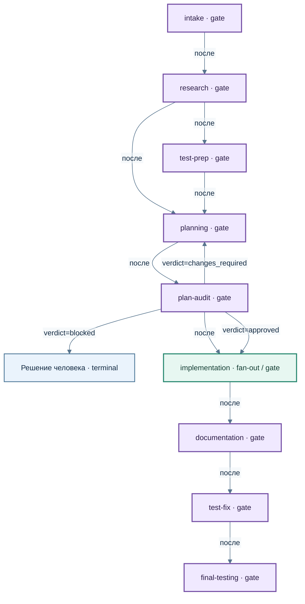

# Поток `issue-delivery`

## Назначение

Универсальный preset для изменения в существующем проекте. Jira, файл, чат или другая система могут быть источником `mirror`; сам маршрут не знает происхождение входа.

## Фактический маршрут preset

```text
intake → research → test-prep → planning → plan-audit
       → implementation fan-out → documentation → test-fix → final-testing
```

В отличие от `jira-fix` и `jira-feature`, здесь план не может быть создан до закрытых research и test-prep. `planning.input_from` явно содержит оба шага, а все зависимости последовательны.

## План и аудит

`planning` — самостоятельная запись только потому, что этому preset нужны отдельный результат, refs, handoff и статус. Большой результат является artifact и по умолчанию может лежать как `artifacts/plan.md`; путь файла не является состоянием flow.

`plan-audit` — read-only запись. В `extra.verdict` обязателен один из вариантов:

Ветвление объявлено как `DECISION-TREE-1` в `flow.json`, а не как свободная логика исполнителя. Корневой узел читает `extra.verdict` закрытого аудита и ведёт только по объявленным маршрутам:

- `approved` — `implementation` может быть создан;
- `changes_required` — движок создаёт новую обычную запись `planning` с `flow_revision: 2` (или следующим номером), затем повторный `plan-audit`;
- `blocked` — реализация не создаётся и требуется решение человека.

`routes` остаётся compatibility-полем для старых FLOW-2 preset; если на шаге объявлен `decision_tree`, runtime использует дерево первым. Маршрут revision не меняет status автоматически. Человек по-прежнему закрывает план и аудит обычными командами; движок только материализует объявленный следующий экземпляр и проверяет `requires`.

## Implementation slices

`planning.extra.slice_list` — массив элементов с `slice_id`, `type`, `title`, `scope`, `depends_on`, `ac`, `tests` и `done_when`. `implementation.fan_out` создаёт по одному обычному `task.json` на элемент, записывает его `flow_item` в строку `index.json` и уважает `max_batch`. Повторный `flow start` создаёт только ещё не материализованные элементы.

`fan_out.join: all_closed` означает, что `documentation` и последующие шаги не создаются, пока все slices текущей revision не закрыты. Это fan-in в логическом flow, а не отдельная очередь: родитель/depends_on остаются обычными полями записей, а `flow_run`, `flow_item` и `flow_revision` — производные поля индекса.

## Документация: вопрос и глобальная policy

`documentation` в этом preset опциональна (`required: false`, `enforcement: advisory`). На входе шага runtime задаёт объявленный FLOW-DOC вопрос: `document_now`, `skip_once`, `switch_to_manual` или `cancel`. Ответ пользователя сохраняется в append-only ledger; исполнителю нельзя молча выбрать ветку за пользователя.

Глобальная policy рабочего пространства задаётся отдельно через `tcheck docs policy set` и имеет приоритет над default потока. Важные режимы:

- `ask` — задать вопрос шага;
- `manual` — не создавать шаг автоматически, но разрешить явный запуск документации;
- `disabled` — автоматически пропустить необязательный documentation с причиной; обязательный шаг даст `DOC_POLICY_CONFLICT`.

Порядок effective policy: workspace → flow/preset → step `documentation` → impact/explicit override → scoped decision для run/task. Это не меняет `flow.json` и не смешивает глобальную настройку с одноразовым ответом на вопрос.

## Выходы и handoff

Каждый закрытый prerequisite должен оставить заявленные `output`: поля `extra`, refs, artifacts или handoff. Результаты не копируются в родителя. `final-testing` принимает только фактическое evidence с командами, кодами возврата и verdict по исходным `AC-N`; подготовленные тесты сами по себе зелёным результатом не считаются.

## Запуск

```bash
tcheck flows show issue-delivery
ttask flow start --flow issue-delivery --from T-001 --by lead
ttask flow state T-001 --flow issue-delivery
ttask flow next T-002
```

Поток создаёт только черновики порцией `max_batch: 5`. Работу переводит в `ready` человек. Состояние запуска живёт в строках `flow`/`flow_step`/`flow_run`/`flow_item`/`flow_revision` производного `index.json`; отдельной очереди процесса нет.

<!-- AUTODOC:BEGIN diagram=flow:issue-delivery source_digest=sha256:63ef367c27f0fd5946d49d155dc1fa74817e9032fbd585408ebf536c456a48a5 projection_digest=sha256:a006bf0a64c1e3d6620157f990f6cd262cf04cb7949c9de31d3e0607bdba20da spec_digest=sha256:1d76fa6e40b07c19b3cb76382c471f547628177b08992785fcf1e8a54cfe6531 -->

<!-- AUTODOC:END diagram=flow:issue-delivery -->
