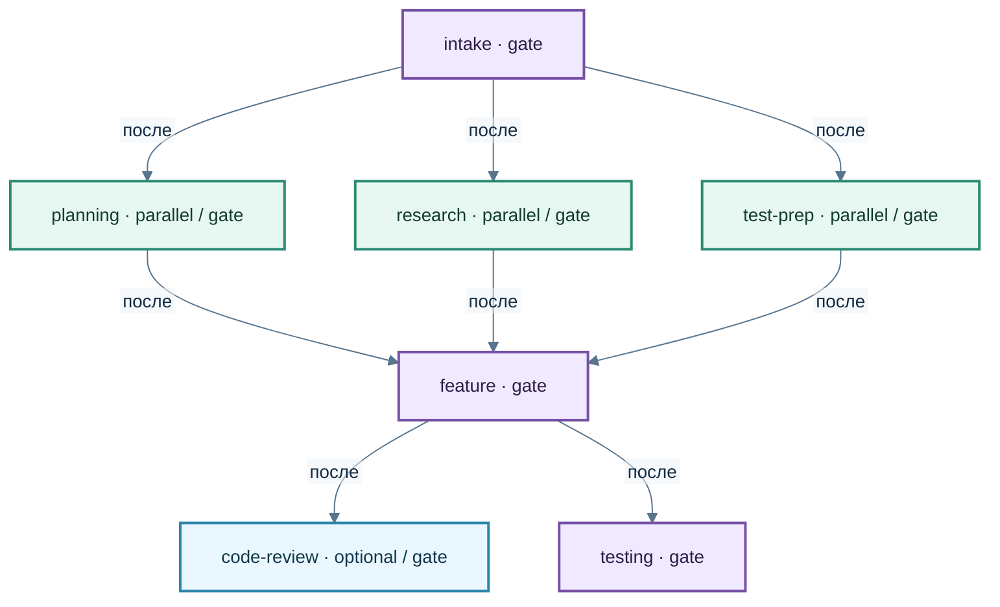

# Поток `jira-feature`

## Назначение

Маршрут для внешней задачи Jira о новой возможности. Входом служит обычная
запись `mirror` или другая запись, от которой человек запускает поток.

## Порядок шагов

```text
intake → (research ∥ planning ∥ test-prep) → feature → (code-review?) → testing
```

- `intake` формализует сырой вход и оставляет `handoff`;
- `research` и `planning` читают общий вход параллельно;
- `test-prep` связывает будущий прогон с критериями;
- `feature` реализует утверждённый план;
- optional `code-review` разбирает дифф;
- `testing` обязан оставить verdict и evidence.

Точные типы, выходы, исполнители и гейты находятся в `flow.json`; этот файл не
дублирует состояние конкретной задачи.

## Как запускать

```bash
tcheck flows show jira-feature
ttask flow start --flow jira-feature --from T-001 --batch 5 --by lead
ttask flow state T-001 --flow jira-feature
ttask flow next T-002
```

`max_batch` равен 5. `flow start` создаёт доступные шаги как `draft`, не делает
их `ready` и не берёт их в работу. Следующий вызов создаёт оставшиеся шаги.
Человек публикует каждый черновик через `ttask status <id> --status ready`.

## Границы

Поток не редактирует зеркало и не создаёт state-файл. `flow` и `flow_step` живут
в строках индекса, а факты — в обычных `task.json`. Не копируй факты между
шагами: оставляй `refs(kind=queue)` и артефакты. Если закрытый входной шаг не
оставил объявленный выход, остановись с `FLOW_OUTPUT_MISSING`.

<!-- AUTODOC:BEGIN diagram=flow:jira-feature source_digest=sha256:99d9fa0625e4db3bb7280cc5791befce16b4ce1be9ebb9dd341356218cbafd23 projection_digest=sha256:d9e047febb5b70cf96e912996db43410bbbe55da579e2ce3fb93dc1557357448 spec_digest=sha256:9d73b60ae5169c3b5c61e9b593f4df0b8d633b965192d015af41388ea4116218 -->

<!-- AUTODOC:END diagram=flow:jira-feature -->
