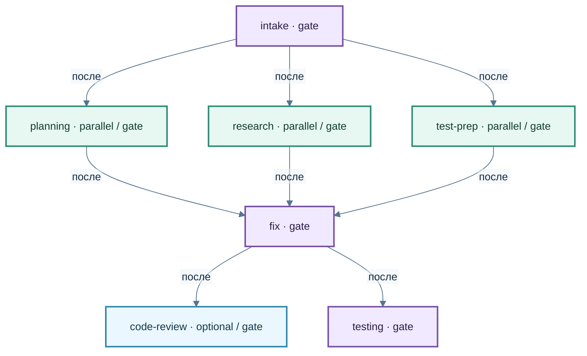

# Поток `jira-fix`

## Назначение

Маршрут для внешнего Jira-дефекта с воспроизведением, минимальным исправлением
и регрессионным прогоном.

## Порядок шагов

```text
intake → (research ∥ planning ∥ test-prep) → fix → (code-review?) → testing
```

`research` ищет причину и подтверждает воспроизведение, `planning` фиксирует
границы и способ исправления, `test-prep` готовит регрессионные проверки,
`fix` меняет код, optional `code-review` проверяет дифф, `testing` оставляет
фактическое evidence и verdict.

Точные `input_from`, `output`, executor, parallel/optional и `gate_out` читаются
из `flow.json`.

## Как запускать

```bash
tcheck flows show jira-fix
ttask flow start --flow jira-fix --from T-001 --by lead
ttask flow state T-001 --flow jira-fix
ttask flow next T-002
```

Порция ограничена `max_batch: 5`; создаются только черновики. Работу публикует
человек: `ttask status <id> --status ready --by <имя>`. После закрытия входных
шагов повтори `flow start`, чтобы создать оставшиеся.

## Границы

Зеркало только читается импортом; служебные уточнения — в дочерней `intake`.
Результат шага не вставляется в родителя. Если заявленный output отсутствует,
следующий шаг возвращает `FLOW_OUTPUT_MISSING`; если индекс и flow.json
расходятся — `FLOW_STATE_MISMATCH`.

<!-- AUTODOC:BEGIN diagram=flow:jira-fix source_digest=sha256:0738ca42b9228ffc7b38b1fd6ff84ec352c02a8ff500d5ec24d9e84cb6eb5567 projection_digest=sha256:46683c72daceaa6bb14bd2a086b6cc0da373d1e57f291a392bca8954f36c54fe spec_digest=sha256:29b4688e8c0ada70d43ddcf052b97e28bc3fb32753735b8955cf0335452957b1 -->

<!-- AUTODOC:END diagram=flow:jira-fix -->
