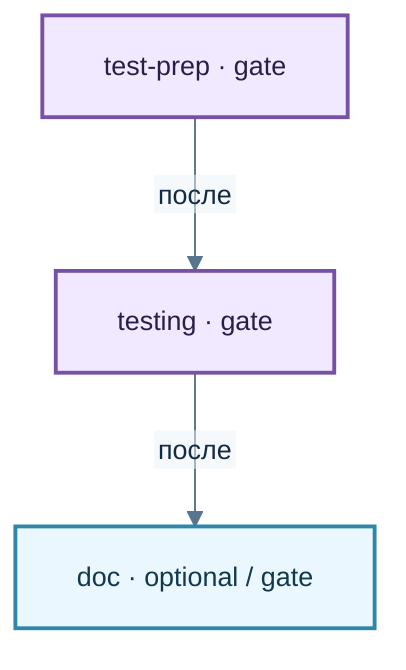

# Поток `release-testing`

## Назначение

Короткий маршрут проверки релиза из текстового входа: сначала подготовить тесты,
затем выполнить прогон и по желанию обновить документацию.

## Порядок шагов

```text
test-prep → testing → (doc?)
```

- `test-prep` формулирует набор проверок и передаёт `handoff`;
- `testing` запускает команды, сохраняет evidence и verdict по AC-N;
- optional `doc` проверяет/обновляет документацию, проходя docs-гейт.

Точные поля `output`, роли и гейты находятся в `flow.json`.

## Как запускать

```bash
tcheck flows show release-testing
ttask flow start --flow release-testing --from T-001 --by lead
ttask flow state T-001 --flow release-testing
ttask flow next T-002
```

`max_batch: 3`. Сначала создаются draft, затем человек переводит их в `ready` и
исполнители оставляют evidence/handoff. Optional шаг не означает, что его выход
можно выдумать: если шаг выбран, он обязан пройти свой gate.

## Границы

Поток — маршрут обычных записей. Он не хранит копию отчёта, не создаёт отдельную
очередь состояния и не изменяет внешний mirror. При отсутствии объявленного
выхода — `FLOW_OUTPUT_MISSING`.

<!-- AUTODOC:BEGIN diagram=flow:release-testing source_digest=sha256:9a5268461d60ee7ce7f8132a8619f49679c8722c809d111a0a7ba102d0b47ecf projection_digest=sha256:7063199b933410b89d3e51af4760f12e38cf1437773ccd0f2ed73130215bccfc spec_digest=sha256:4b89d82033a87455fe0d551a34869c22a5924644aefa39e201639be228054fc6 -->

<!-- AUTODOC:END diagram=flow:release-testing -->
